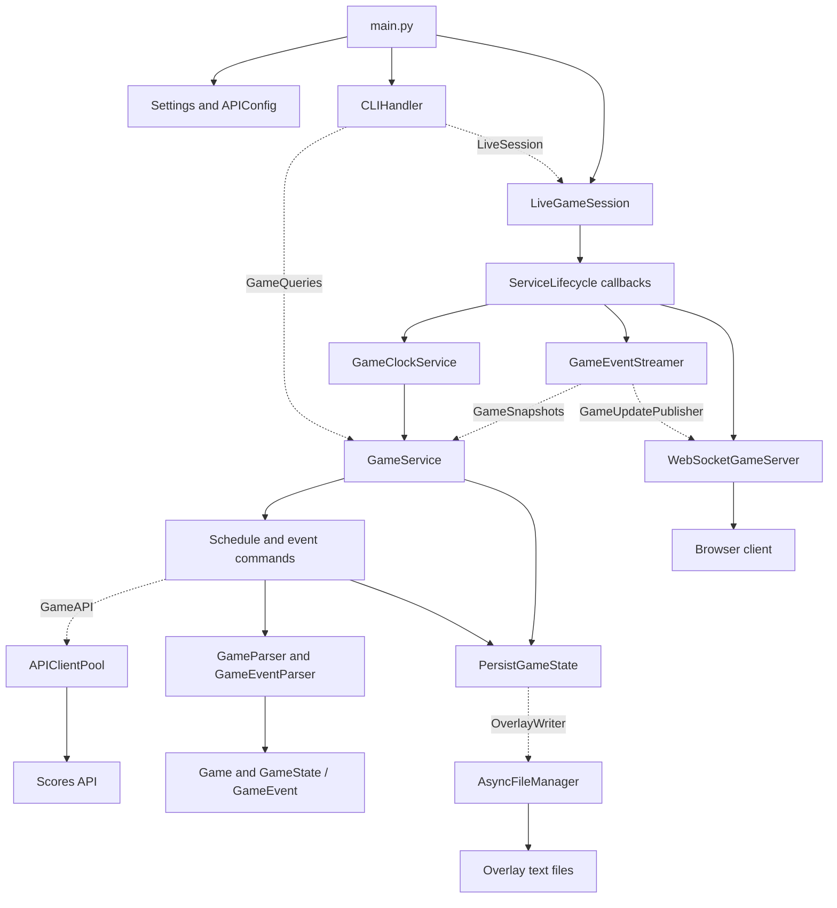

# Architecture

[Back to README](../README.md)

StreamClient separates domain models, application operations, infrastructure, and CLI presentation. [main.py](../main.py) constructs concrete dependencies, scopes application-owned signals, and closes the shared API client. The CLI, query commands/services, clock adapter, and monitor depend on focused application Protocols rather than concrete infrastructure. LiveGameSession owns startup and shutdown through injected callbacks. PersistGameState owns snapshot-to-overlay mapping through OverlayWriter. See the [lifecycle explanation](lifecycle.md) and [implementation report](review.md) for the SOLID mapping and asyncio behavior.

The diagram shows implemented dependencies; dashed arrows name the application contracts satisfied by infrastructure/services.

## Components

| Location | Responsibility |
| --- | --- |
| `config/settings.py` | Runtime, output, and WebSocket settings |
| `src/infrastructure/api/config.py` | Upstream URL and headers |
| `src/presentation/cli.py` | Arguments, command selection, and displayed output |
| `src/application/ports.py` | Focused query, session, API, overlay, snapshot, publisher, and clock contracts |
| `src/application/services/live_session.py` | Generic live-service supervision and cleanup |
| `src/application/services/game_service.py` | Schedule/event requests and countdown loop |
| `src/application/services/game_clock_service.py` | Starts and cancels the background clock |
| `src/application/commands/process_game.py` | Schedule, event-only, and event-with-persistence commands |
| `src/application/commands/persist_game_state.py` | Shared mapping of a fetched snapshot to ten overlay files |
| `src/application/parsers/` | API JSON parsing and score/team extraction |
| `src/domain/models/` | Game, GameState, GameEvent, and Player dataclasses |
| `src/infrastructure/api/client.py` | HTTP pooling, TTL cache, optional retry client |
| `src/infrastructure/persistence/async_file_manager.py` | Creates directories, writes UTF-8 text/rosters, deletes files |
| `src/infrastructure/signals.py` | Scoped cancellation over default process handlers; preserves host signal ownership |
| `src/infrastructure/websocket/` | API polling and broadcast server |
| `client/` | Static HTML/JavaScript subscriber demonstration |

## Query flows

**Schedule:** `CLIHandler` calls `GameService.get_game_schedule(date)`, which executes `ProcessGameSchedule`. The command reads a cached or fresh response, parses Game objects, and joins their string representations. It does not persist schedule data.

**Game snapshot:** `get_game_events_with_persistence(game_id)` fetches/parses through `get_game_events()`, then calls explicit `persist_game_state(state)` without another HTTP request. The latter delegates to PersistGameState, which maps ten overlay files through OverlayWriter. ProcessGameEventsWithPersistence remains available and reuses the same mapping. Files are written sequentially.

**Live polling:** `GameEventStreamer.start_monitoring()` adds a game to its active set, creates a background polling task, and returns that task for supervision. Calling it for an already active game returns the existing task. Each iteration fetches once through GameSnapshots, explicitly persists that snapshot, and optionally publishes its JSON dictionary through GameUpdatePublisher. File-only mode rewrites every successful poll. WebSocket mode persists changed/pending snapshots and separately tracks successful delivery, so send retries do not repeat successful persistence.

Fetch, persistence, and delivery have independent failure counters. A successful fetch resets fetch failures even without a state change. Each stage delays by `polling_interval * (error_count + 1)` after failures one through four and raises the fifth failure to the supervisor. Failed writes/sends invalidate their checkpoint, including partial-output cases where upstream state later reverts. Cancellation propagates and clears the active flag. Retries coalesce to the newest fetched state; partial delivery may cause duplicates. See [protocols.md](protocols.md).

**WebSocket output:** the server stores immutable serialized snapshots per game, tracks one normalized game subscription per connection, and routes matching updates only. An acknowledgment is followed by the latest snapshot when available. A common delivery lock orders replay against broadcasts; sends run concurrently with bounded timeouts. Subscriptions never initiate polling.

## Clock

`GameClockService.start()` creates a background `GameService.run_game_clock()` task and returns that task for supervision. The loop checks wall-clock time every 0.1 seconds, writes `clock.txt` about once per wall-clock second, and requests game state at five-second boundaries.

The implementation interprets upstream `ts.time` and `ts.ds` in tenths of a second, using `ceil(int(time) / 10)` for accumulated game time and `round(int(ds) / 10)` for the stopwatch timestamp. This interpretation comes from the code and was not verified with the upstream service.

When stopped, remaining time is duration minus accumulated time. When running, elapsed time since the stopwatch timestamp is also subtracted. Remaining time is clamped at zero and formatted as `MM:SS`; reaching zero does not stop the loop. The clock uses system wall time rather than a monotonic timer.

## Models and persistence

- Game holds one schedule entry.
- GameState holds timing, teams, string scores, roster maps, scoring events, and latest scorer/assist. Missing collections become empty dictionaries/lists.
- GameEvent holds a timestamp, team marker, type, scorer, assist, and event scores. Only type `S` is retained by the parser. Its explicit dictionary representation makes scoring snapshots JSON-compatible.
- Player is defined, but parsed rosters remain dictionaries rather than Player objects.

Latest scoring information is selected by maximum event timestamp. Nonempty scores from that event override the top-level scores. Rosters preserve parsed dictionary order when written.

Files are opened in write mode. Text fields have no added newline; roster entries do. There is no database, historical event store, transaction across files, or per-game output namespace.

## Task ownership

The CLI delegates live mode to LiveSession.run(). LiveGameSession records each attempted start, registers the actual running tasks, and uses [asyncio.wait(..., return_when=FIRST_COMPLETED)](https://docs.python.org/3.12/library/asyncio-task.html#asyncio.wait) to supervise them. Completed-task failures propagate to the caller; normal completion of any service also ends the session. File-only mode continues until cancellation or a loop stops, independently of WebSocket support.

On exit, the session cancels and awaits all registered tasks, then attempts every service stop call. Stop methods clear their state and consume task results without re-raising previously observed runtime failures. Cleanup errors cannot replace the original service error or cancellation; without an original error, a cleanup failure propagates. main.py applies the same primary-error preservation to HTTP closure. The server has no process signal ownership; application/host cancellation reaches the session. The [lifecycle guide](lifecycle.md) explains wait(), gather(), and cancellation; the [implementation report](review.md) records verification and remaining operational limits.
